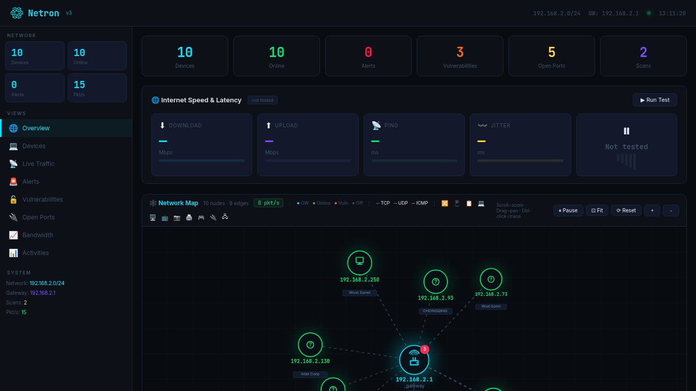

<div align="center">

<pre>
███╗   ██╗███████╗████████╗██████╗  ██████╗ ███╗   ██╗
████╗  ██║██╔════╝╚══██╔══╝██╔══██╗██╔═══██╗████╗  ██║
██╔██╗ ██║█████╗     ██║   ██████╔╝██║   ██║██╔██╗ ██║
██║╚██╗██║██╔════╝   ██║   ██╔══██╗██║   ██║██║╚██╗██║
██║ ╚████║███████╗   ██║   ██║  ██║╚██████╔╝██║ ╚████║
╚═╝  ╚═══╝╚══════╝   ╚═╝   ╚═╝  ╚═╝ ╚═════╝ ╚═╝  ╚═══╝


</pre>

**Real-time network monitoring, vulnerability detection & traffic analysis dashboard**

</div>

---

## 📸 Dashboard



---

## ✨ Features

- 🌐 **Live Network Map** — Interactive node graph with TCP/UDP/ICMP/ICMPv6/ARP traffic visualization
- 📡 **Device Discovery** — Auto-detects all devices on the local subnet with OS
  and vendor fingerprinting. Names come from reverse DNS first, then the host's
  own mDNS and NetBIOS answers, so devices without PTR records still get a real
  name. Vendors come from the built-in OUI table plus the vendor APIs; a banner
  string like `lighttpd` is never reported as a manufacturer, and a vendor that
  sells several product lines (Apple, Samsung, HP) does not get a guessed
  device type — type comes from OUI product line, hostname, open ports and OS
- ⚡ **Internet Speed & Latency** — Real download/upload/ping/jitter measurement. The
  test runs in a background thread and streams its phase, progress and live numbers to
  the panel, so it finishes in 15–30 s with visible progress instead of blocking on one
  request. Download uses four parallel TLS streams (a single stream is bounded by the
  TCP receive window and under-reports: measured 3.2 vs 9.8 Mbps on the same link);
  ping is the median TCP handshake RTT with DNS resolved outside the timed section;
  jitter is the mean difference between consecutive samples. `speedtest-cli` is used
  when installed. If nothing can be reached the panel says so rather than showing a
  made-up number
- 🚨 **Alert Engine** — 47 detection rules over live traffic, host auth logs and scan
  results. Every alert carries an ATT&CK technique id and a suggested response
  action; repeats are deduplicated, rate-limited and correlated into incidents.
  Rules whose telemetry is unavailable are listed as *inactive with the reason*
  instead of firing blind
- 📡 **Live Traffic** — Wireshark-style table of every observed packet/flow
  (protocol, source, destination, port, flags, size, TLS SNI, DNS question) with
  protocol filters and pause/live toggle
- 🛡️ **Vulnerabilities** — Network-wide exposure list built from the open ports
  Netron actually saw, with per-port risk notes and severity counts. Every online
  device is swept in parallel on a fixed cadence, and the panel states how many
  devices were assessed out of how many are known
- 🧭 **Open Ports** — Every host/port pair discovered on the subnet, filterable by
  port or service, flagged when the service is risky
- 📊 **Bandwidth Monitor** — Per-device byte totals, 60-second windows and learned
  host baselines from captured packets (root + Scapy), plus top flows. In psutil
  mode there are no packet bytes to count, so the panel shows zero rather than an
  estimate
- 🖥️ **Multi-view Sidebar** — Overview, Devices, Live Traffic, Alerts,
  Vulnerabilities, Open Ports, Bandwidth, Activities

---

## 🚀 Installation

### 1. Clone the Repository

```bash
git clone https://github.com/maulezero/netron.git
```

### 2. Navigate into the Project

```bash
cd netron
```

### 3. Create and Activate a Virtual Environment

No virtual environment is included in the repo — create one first.

**macOS / Linux:**
```bash
python3 -m venv venv
source venv/bin/activate
```

**Windows:**
```bash
python -m venv venv
venv\Scripts\activate
```

### 4. Install Dependencies

```bash
pip install -r requirements.txt
```

---

## 🛡️ Detection Coverage

Netron only reports what it can actually observe:

| Source | What it provides | Rules |
|--------|------------------|-------|
| Live capture (root + Scapy) | Network-wide packets and conversations | 40 |
| Live capture — VoIP labelling | SIP, SIP/TLS, RTP, RTCP, H.323, MGCP, SCCP, STUN, IAX2 on captured packets (see note below) | — |
| Host auth log (Linux) | SSH failed/successful logins from `/var/log/auth.log` | 4 |
| Port scans (rustscan discovery, then nmap probe, or TCP-connect fallback) | Per-host open ports and the service on each | 1 |
| Local inventory file | MAC address history | 1 |
| RDAP lookups (opt-in) | Domain registration age | 1 |

VoIP labelling uses two kinds of evidence and never guesses: the port assigned to
a VoIP protocol (works in both capture modes), or the bytes on the wire — a SIP
request/status line, or a well-formed RTP/RTCP header (version 2, a registered
payload type, consistent length). RTP and RTCP use dynamic ports, so they are
only reported from the header check, which needs the payload and therefore root
+ Scapy. In psutil mode the Live Packet Capture panel says RTP needs payload
capture instead of listing guessed media; only the port-labelled protocols
(SIP, SIP/TLS, H.323, MGCP, SCCP, STUN, IAX2) can appear there. Counts come from
the capture buffer, so a protocol appears only after one of its packets was
actually seen.

Coverage by technique family: reconnaissance/scanning, layer-2 poisoning
(ARP/DHCP/VLAN), name resolution (LLMNR/NBT-NS, DNS tunnelling, DGA, NXDOMAIN),
SMB and Windows lateral movement (admin shares, signing disabled, DRSUAPI), credential
abuse (Kerberos RC4/TGS bursts), C2 (Tor exits, mining pools, RMM tooling, DoH,
beaconing), exfiltration (cloud upload, SMTP, volume/off-hours outliers),
exposure (inbound admin ports), denial of service, authentication attacks and
asset inventory drift.

Every alert is produced through the same pipeline:

1. **Observe** — packets, flows, auth lines, scan results.
2. **Baseline** — per-host role, open ports, byte volume, DHCP fingerprint, known MACs.
3. **Enrich** — hostname, vendor, device type, role, criticality, VLAN, owner
   (from the inventory file), geo/ASN and threat-intel hits (Tor exit list,
   `NETRON_TI_LIST`).
4. **Score & correlate** — alerts from the same host within 15 minutes share one
   incident id, and an alert from a second technique family bumps its severity
   one level (for example scan → auth failures → successful login is reported as
   one correlated incident).
5. **Deduplicate & rate-limit** — a repeating alert updates its own entry
   instead of flooding the list; per-rule cooldowns and a global cap apply.

Detections that would require decrypted authentication or Windows Domain
Controller audit logs (RDP/SMB/LDAP/Kerberos/VPN failed-login events,
AS-REQs without pre-authentication, NTLM to unusual destinations) are **not
faked**: `/api/detections` reports them as inactive with the missing telemetry.

---

## ▶️ Usage

**macOS / Linux:**
```bash
python3 netron.py
```

**Windows:**
```bash
python netron.py
```

Then open your browser and navigate to:

```
http://localhost:5000
```

---

## 🗂️ Project Structure

```
netron/
├── netron.py            # Main application (server + inline dashboard)
├── requirements.txt     # Python dependencies
├── assets/
│   └── netron.png       # Logo, served at /assets/netron.png and /favicon.ico
├── dashboard.png        # UI screenshot
├── LICENSE
└── README.md

Created at runtime (not in the repo):
├── .cache/netron-inventory.json   # MAC → first/last seen, owner, criticality
└── .cache/tor-exits.txt           # Cached Tor exit-node list (24 h)
```

---

## ⚙️ Requirements

- Python 3.8 or higher (a C compiler may be needed if no `netifaces` wheel
  exists for your interpreter)
- A virtual environment (`venv`) — create one as shown above
- Network interface with access to the local subnet
- Root / Administrator privileges recommended for full packet capture and the
  network-wide detection rules (root + Scapy: IPv4/IPv6/ARP with TCP, UDP, ICMP,
  ICMPv6 and other Internet protocols; without root, psutil mode reports TCP/UDP
  flows only and the capture-based rules show as inactive)

### Optional extras

| Tool | Purpose |
|------|---------|
| `nmap` binary on `PATH` | Service/version names on every discovered open port, OS detection; without it only the built-in TCP-connect fallback runs |
| `rustscan` binary on `PATH` | Fast port discovery in front of nmap; without it nmap does discovery as well. `-t 3000 --tries 2` are fixed: the default 1500 ms timeout was measured dropping real open ports |
| `pip install speedtest-cli` | Measure against the speedtest.net node chosen for you; without it the built-in Cloudflare multi-stream probe is used |
| `libpcap` (Linux/macOS) or Npcap (Windows) | Required by Scapy for live packet capture |

### Configuration

| Environment variable | Default | Purpose |
|----------------------|---------|---------|
| `NETRON_HOST` | `0.0.0.0` | Address the dashboard binds |
| `NETRON_PORT` | `5000` | Port the dashboard binds |
| `NETRON_SITE_ICONS` | `0` | Set to `1` to enable the `/favicon/<host>` proxy, which fetches third-party site icons (sends your host's requests to those sites) |
| `NETRON_AUTH_LOG` | auto | Path to the auth log to tail (defaults to `/var/log/auth.log`, `/var/log/secure`, …). Without it the four authentication rules report inactive |
| `NETRON_SCAN_HOSTS` | `10` | Hosts contacted within the window (60 s) before a horizontal scan alert |
| `NETRON_SCAN_PORTS` | `15` | Ports hit on one host before a vertical scan alert |
| `NETRON_SCAN_WORKERS` | `24` | Hosts deep-scanned concurrently (hostname, TTL, banner, OS, vendor, ports) |
| `NETRON_VULN_WORKERS` | `16` | Hosts port-scanned concurrently by the vulnerability sweep |
| `NETRON_VULN_INTERVAL` | `60` | Seconds between network-wide vulnerability sweeps |
| `NETRON_RUSTSCAN_RANGE` | *(empty)* | Extra port range rustscan also probes (`1-2000`, `1-65535`, …). Empty = the 86-port `SCAN_PORTS` list only. A full range measured ~95 s per host on Wi-Fi, so it is opt-in |
| `NETRON_RUSTSCAN_TIMEOUT` | `180` | Hard ceiling, in seconds, for one rustscan run; a scan that exceeds it is treated as failed, never as "no ports" |
| `NETRON_PORT_RETENTION` | `900` | Seconds a port seen open stays listed when a later scan misses it (it is dropped sooner after three consecutive empty sweeps, and never listed unless a scan saw it open) |
| `NETRON_ID_INTERVAL` | `300` | Seconds between full re-identifications of one host (name, banner, OS, vendor). Ports stay fresh via the vulnerability sweep |
| `NETRON_TOR_FEED` | `1` | Set to `0` to skip downloading the Tor exit-node list |
| `NETRON_TI_LIST` | *(none)* | File of IPs/CIDRs (one per line, `#` comments) used for threat-intel enrichment |
| `NETRON_GEO` | `0` | Set to `1` for geo/ASN enrichment via `ip-api.com` (public destinations only, cached) |
| `NETRON_RDAP` | `0` | Set to `1` to enable newly-registered-domain lookups (RDAP) |
| `NETRON_HONEYPOT_NAMES` | *(none)* | Comma-separated decoy hostnames; queries for them raise an alert |
| `NETRON_LLMNR_RESPONDERS` | *(none)* | Comma-separated IPs allowed to answer LLMNR/NBT-NS |
| `NETRON_DHCP_SERVERS` | *(none)* | Comma-separated legitimate DHCP server IPs |
| `NETRON_RESTRICTED_VLANS` | *(none)* | Comma-separated VLAN ids where new devices raise an alert |
| `NETRON_APPROVED_DOH` | *(none)* | Comma-separated DoH resolver suffixes considered sanctioned |
| `NETRON_APPROVED_RMM` | *(none)* | Comma-separated remote-management domains considered approved |
| `NETRON_INVENTORY` | `.cache/netron-inventory.json` | Inventory file (MAC history, owner, criticality) |
| `NETRON_BUSINESS_START` / `NETRON_BUSINESS_END` | `7` / `19` | Business-hours window (local hours) used by off-hours transfer alerts |

### ⚠️ Security Note

Netron is a **local network tool**. The dashboard has no login — anyone
who can reach the host on the configured port can view everything. Actions that
change state (rescan, block/unblock, speedtest) require a per-run token that the
dashboard injects into the page, which stops plain cross-site requests but is
**not** authentication: the token ships with the page. Keep it on a trusted
network, and prefer binding via `NETRON_HOST=127.0.0.1` when you don't need
remote access (the startup banner prints the address actually bound).

---

## 🤝 Contributing

Pull requests are welcome. For major changes, please open an issue first to discuss what you'd like to change.

---

## 📄 License

MIT © [github.com/maulezero](https://github.com/maulezero) — see [LICENSE](LICENSE).

---

<div align="center">
<sub>Built with 🖤 for network defenders and red teamers</sub>
</div>